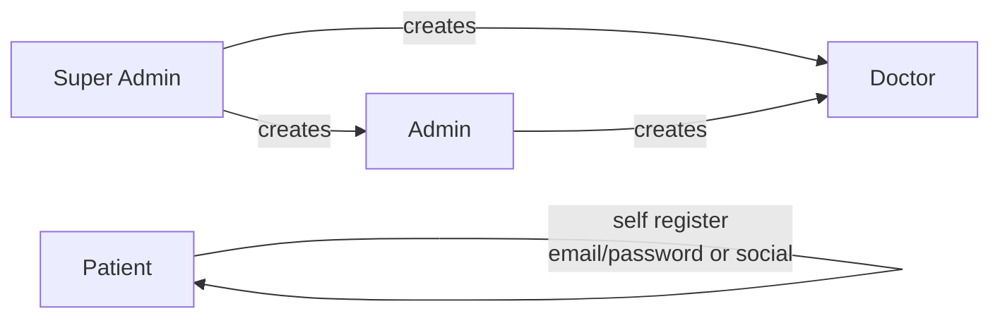
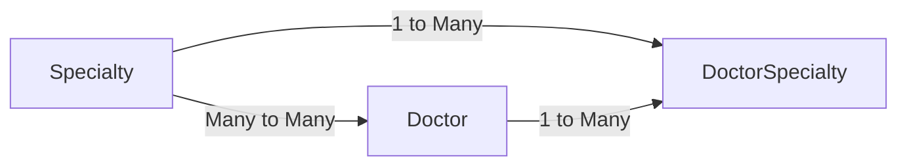
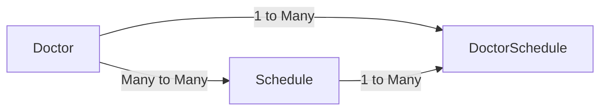
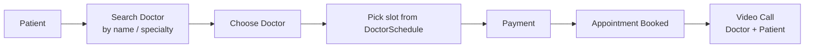
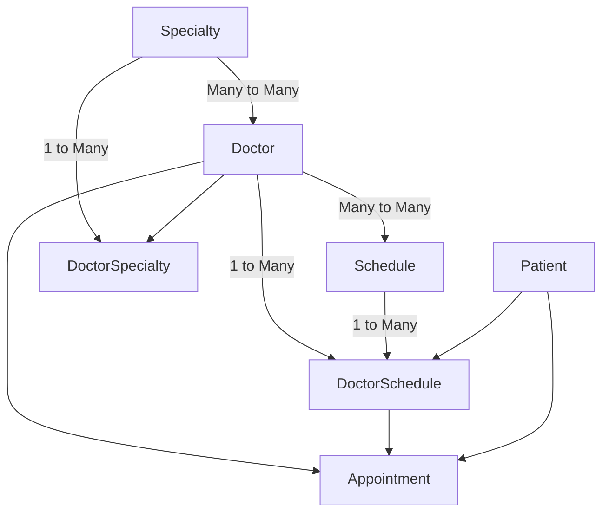

# 37-01 Project Requirement Analysis

> PH Healthcare (PERN stack) — project শুরু করার আগে requirement analysis। Excalidraw-এ diagram এঁকে দেখা হয়েছে কোন ধরনের user থাকবে, কে কী করতে পারবে, আর entity-গুলোর মধ্যে relation কেমন হবে।

---

## 1. User Roles

Project-এ মোট ৪টা role থাকবে:

| Role | Account কে create করে | Login method |
|------|------------------------|--------------|
| `SUPER_ADMIN` | (system / seed) | Email + Password |
| `ADMIN` | `SUPER_ADMIN` | Email + Password |
| `DOCTOR` | `SUPER_ADMIN` বা `ADMIN` | Email + Password |
| `PATIENT` | নিজে (self registration) | Email + Password **অথবা** Social Auth |

### Account creation rules
- **Patient** নিজে register করতে পারবে — email/password দিয়ে বা social auth (Google ইত্যাদি) দিয়ে।
- **Doctor** আর **Admin** নিজে account create করতে পারবে **না**।
  - `SUPER_ADMIN` → `ADMIN` create করবে।
  - `ADMIN` / `SUPER_ADMIN` → `DOCTOR` create করবে।
- Doctor আর Admin-এর জন্য **কোনো social login নেই**।



---

## 2. Doctor খোঁজা (Search)

Patient দুইভাবে doctor খুঁজবে:
1. **Name দিয়ে** — doctor খুব popular হলে সরাসরি নাম দিয়ে search।
2. **Specialty দিয়ে** — যেমন Cardiology, Neurology ইত্যাদি।

---

## 3. Specialty ↔ Doctor (Many-to-Many)

- একজন doctor-এর একাধিক specialty থাকতে পারে, আর একটা specialty-তে অনেক doctor থাকতে পারে → **Many-to-Many**।
- Many-to-Many relation হলে মাঝখানে একটা **bridge (junction) table** বানাতে হয় → `DoctorSpecialty`।
- `Specialty` আর `Doctor` create করবে **Admin / Super Admin**, তারপর এই দুইটা থেকে `DoctorSpecialty` তৈরি হবে।



> 💡 Many-to-Many কে আসলে দুইটা **One-to-Many** relation-এ ভেঙে ফেলা হয়:
> `Specialty (1) → (N) DoctorSpecialty (N) ← (1) Doctor`

---

## 4. Schedule ↔ Doctor (Many-to-Many)

- Hospital-এর **schedule** (time slot) create করবে **Admin / Super Admin**।
- Doctor সেই hospital schedule থেকে নিজের schedule ঠিক করবে।
- Doctor আর Schedule-এর relation-ও **Many-to-Many** → মাঝখানে bridge table `DoctorSchedule`।
- `DoctorSchedule` create করবে **Doctor নিজে**।

```
Doctor  →  DoctorSchedule  ←  Schedule
```



---

## 5. Appointment Flow

1. Patient আসবে → specialty (বা name) অনুযায়ী doctor search করবে।
2. একজন doctor choose করবে → appointment booking-এ যাবে।
3. Appointment **কোন সময়ে** হবে সেটা ঠিক হবে `DoctorSchedule` থেকে।
4. তারপর **Payment** → payment সফল হলে appointment **book** হয়ে যাবে।
5. নির্ধারিত সময়ে doctor আর patient দুজনেই **video call**-এ join করবে।



---

## 6. Full Entity Relation Overview



| Entity | কে create/manage করে |
|--------|----------------------|
| `Specialty` | Admin / Super Admin |
| `Doctor` | Admin / Super Admin |
| `DoctorSpecialty` | Admin / Super Admin (Specialty + Doctor থেকে) |
| `Schedule` | Admin / Super Admin |
| `DoctorSchedule` | Doctor |
| `Appointment` | Patient (DoctorSchedule-এর slot থেকে) |

---

## Key Takeaways
- ৪টা role: `SUPER_ADMIN`, `ADMIN`, `DOCTOR`, `PATIENT`।
- শুধু Patient self-register + social login করতে পারে।
- Many-to-Many হলে সবসময় মাঝখানে bridge table: `DoctorSpecialty`, `DoctorSchedule`।
- Appointment-এর time আসে `DoctorSchedule` থেকে; payment-এর পর booking confirm; তারপর video call।


db erd: https://drive.google.com/file/d/1zEVQcl3z6Hk017BgMW98hg6ihPTCijvc/view?usp=sharing 

email: arifcatch@gmail.com